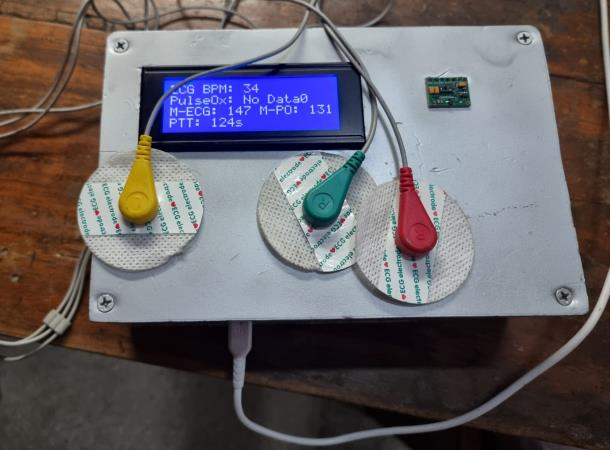
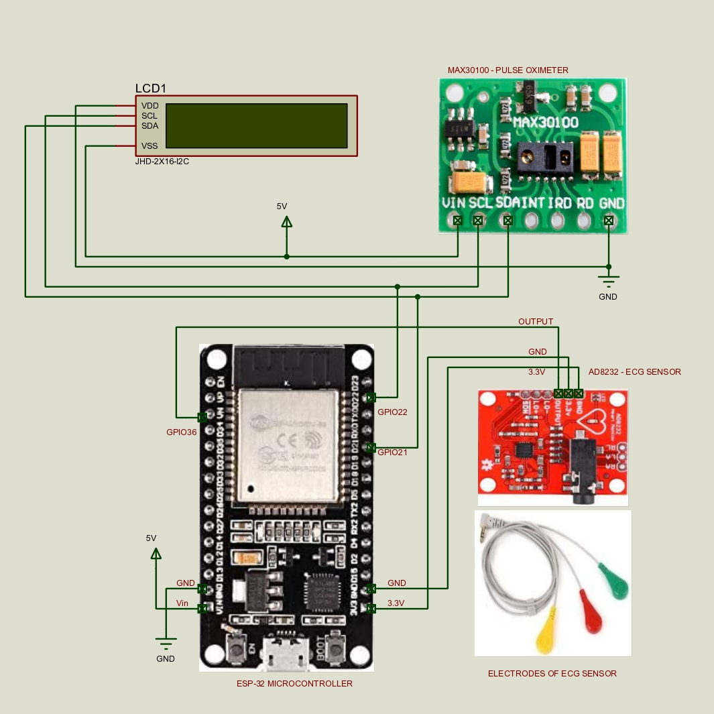

# 🫀 PTT (Pulse Transit Time) Blood Pressure Monitoring Device

!\[License](https://img.shields.io/badge/license-MIT-blue.svg)
!\[Board](https://img.shields.io/badge/board-ESP32-E7352C.svg)
!\[Language](https://img.shields.io/badge/language-Arduino%20C%2B%2B-00979D.svg)

A low-cost, non-invasive device that tracks heart activity with two sensors, an
**ECG** (AD8232) and a **pulse oximeter** (MAX30100), to study blood pressure
through **Pulse Transit Time (PTT)**: the delay between the heart's electrical
signal and the pulse reaching the fingertip.

Built as a team project for Capstone Design II (IPE 4710, Group 05)
at the Islamic University of Technology, March 2025. Repository maintained by
**Zahin Tasnim Ridita**.

📄 [**Read the full project report**](report/Capstone_Report_Group5.pdf) (public copy)

<p align="center">
  
</p>

## 🎯 Outcome

1. **Built:** a working PTT blood pressure monitor (ESP32, AD8232 ECG, MAX30100 pulse oximeter, 20x4 LCD, hand-built
enclosure) for about 24,000 BDT using parts from local suppliers.
2. **Tested in the capstone:** in the team's five-person validation session, the PTT-based systolic estimates were within
about 4 mmHg of a cuff (reported as 3.8 mmHg; 4.4 mmHg when recomputed from the report's Table D.1), against an IEEE 1708
target of 5 mmHg.
3. **Reviewed afterwards:** a later code review found three signal-processing issues in the final program; version 2 fixes them.
4. **Checked on public data:** version 2 was run on 13 real recordings from a public dataset: 98.6% heartbeat detection,
and PTT that shortens with exertion in 8 of 8 comparisons. That dataset was too small, and its cuff reference too noisy,
to confirm or contradict the blood pressure result from step 2 ([details](validation/README.md)).

\---

## ✨ What the device does (final build)

* 🫀 Reads the ECG signal from the AD8232 and detects heartbeats with a
moving-average filter and a self-adjusting threshold.
* 🩸 Reads heart rate and SpO2 from the MAX30100 pulse oximeter.
* 📈 Tracks the maximum ECG and pulse-oximeter heart rates in each
one-minute window, and when each maximum occurred.
* ⏱️ Reports the time between those two maximum moments as "PTT", then
resets every 60 seconds.
* 🖥️ Shows everything live on a 20x4 I2C LCD and prints readings over Serial.

\---

## 🔧 Hardware

|Component|Connection|
|-|-|
|ESP32 dev board|Microcontroller|
|AD8232 ECG module|Output → `GPIO36` (VP)|
|MAX30100 pulse oximeter|I2C: SDA `GPIO21`, SCL `GPIO22`|
|20x4 I2C LCD (address `0x27`)|Same I2C bus|
|3 ECG electrodes|Right arm, left arm, ground|

<p align="center">
  
</p>

The development steps ran on an **Arduino Uno** with a **16x2 LCD** and the ECG
on pin `A0`, before the design moved to the ESP32.

\---

## 📁 Repository structure

```
firmware/
├── final/FINAL\_PROGRAM/            ← the program that ran on the finished device (unchanged)
├── development/                    ← how it was built up, step by step (unchanged)
│   ├── step1\_ecg\_only/                     ECG sensor + LCD
│   ├── step2\_pulse\_oximeter\_only/          Pulse oximeter + LCD
│   ├── step3\_ecg\_and\_pulse\_oximeter/       Both sensors together
│   ├── step4\_max\_heart\_rate\_per\_minute/    Max heart rate per minute
│   └── step5\_max\_heart\_rate\_time\_distance/ Time between the two maximums
└── v2\_revised/PTT\_MONITOR\_V2/      ← version 2: fixes the known issues below
validation/                         ← version 2 tested on 13 real recordings (code, results, figures)
tests/detector\_simulation.py        ← quick check of the ECG beat detection on synthetic signals
docs/                               circuit diagram, prototype photo, workflow flowchart
report/                             capstone report (PDF, public copy)
```

\---

## 🚀 Flashing

1. Install the **ESP32 board package** in the Arduino IDE.
2. Install two libraries (Sketch → Include Library → Manage Libraries):
`LiquidCrystal\_I2C` and `MAX30100lib` (by OXullo Intersecans).
3. Open `firmware/final/FINAL\_PROGRAM/FINAL\_PROGRAM.ino` (original) or
`firmware/v2\_revised/PTT\_MONITOR\_V2/PTT\_MONITOR\_V2.ino` (version 2), select
your ESP32 board and port, and upload.
4. Open the Serial Monitor at **115200 baud**. Version 2 prints one CSV line per
heartbeat: `time\_ms, ecg\_bpm, po\_bpm, spo2, ptt\_ms, ptt\_median\_ms`.

For the development steps, select **Arduino Uno** as the board.

\---

## 📊 Results reported in the capstone report

|Metric|Reported result|
|-|-|
|Mean absolute error vs. cuff, 5-user validation session (Appendix D)|≈ 3.8 mmHg stated in the report; 4.4 mmHg recomputed from Table D.1 (all five estimates were 3 to 5 mmHg above the cuff)|
|ECG heart rate range|83–120 bpm|
|Pulse oximeter heart rate range|72–81 bpm|
|Target standard|IEEE 1708 (±5 mmHg)|

The 3.8 mmHg figure comes from the report's validation session, which lists PTT
in milliseconds (220–260 ms) and estimates blood pressure with the linear model
in Appendix A (`BP = a × PTT + b`). The final program in this repository does not
calculate blood pressure and displays PTT in whole seconds, so those
millisecond values were not produced by this firmware as written.

\---

## ⚠️ Known issues in the original final program

The original program is kept unchanged as a record of what was built. All three
issues are fixed in version 2.

1. **The displayed PTT is not a physiological pulse transit time.** The program
compares the moments when each sensor recorded its highest heart rate within a
one-minute window. Both times reset to zero every 60 s, so if the pulse
oximeter records a maximum before the ECG does, the display shows the time
since power-on instead. The "PTT: 124s" in the prototype photo is most likely
this: 124 s after switching on. Real PTT is about 0.2 s, measured beat by beat.
2. **The ECG threshold was written for the Arduino Uno.** It starts at 512 and
triggers at "average + 10", which suits the Uno's 10-bit input (0–1023). The
ESP32 reads 0–4095, so a margin of 10 is tiny and noise can count as heartbeats.
In simulation (`tests/detector\_simulation.py`), this logic reported 129–194 bpm
for true rates of 60–110 bpm, and 37–74 "beats" in 30 s of noise alone.
3. **LCD updates can starve the pulse oximeter.** The screen is cleared and fully
rewritten every second over I2C, while the MAX30100 library needs `pox.update()`
called very frequently. This is a likely cause of the "PulseOx: No Data" in the
prototype photo.

\---

## 🔁 Version 2 (revised firmware)

`firmware/v2\_revised/PTT\_MONITOR\_V2/PTT\_MONITOR\_V2.ino` keeps the same wiring and fixes the issues above:

* **Beat-to-beat PTT in milliseconds:** time from each ECG R-peak to the next
pulse-oximeter beat, shown as the median of the last 8 beats.
* **Slope-based R-peak detection** (the idea behind the Pan–Tompkins detector):
each heartbeat's steep slope is compared with the measured noise level, so the
threshold adapts to each person and to the ESP32's 12-bit input.
* **Row-by-row LCD updates** without clearing the screen, so the pulse oximeter
is serviced often.
* **Fixed 250 Hz ECG sampling** and a **CSV output** for logging and calibration.

### Version 2 validation on real recordings

Version 2 was tested by compiling the unmodified firmware for a PC and running it on **13 real recordings from 5 people**
(seated, walking and running, about 8 minutes each) from a public dataset with manually verified heartbeat annotations and cuff
blood pressure. Method, per-recording results and limitations: [**validation/README.md**](validation/README.md).

|Result|Value|
|-|-|
|Heartbeats found (8,251 annotated)|**98.6% sensitivity, 98.4% precision** (11 of 13 recordings above 99.5%)|
|Heart rate vs annotations|within 0.15 bpm (median), 0.54 bpm (worst)|
|Beat timing|10 ms before the annotated R-peak, 1.8 ms variation|
|Beat-by-beat PTT readings|7,703|
|Mean PTT, seated / walking / running|390 / 290 / 352 ms; shorter than at rest in 8 of 8 comparisons|
|Spread of the displayed value, mean → median of 8|35 → 31 ms (37 → 30 ms walking/running)|

!\[Validation summary](validation/figures/fig2\_validation\_summary.png)

The validation changed the firmware once: the displayed PTT became the **median** of the last 8 readings instead of the mean.

**Blood pressure on the public data.** PTT shortened in every walking or running recording. This dataset is too small to confirm
or contradict the capstone's blood pressure result, which used a different design (a per-session calibration, five people, one
cuff reading each). Here, with one resting reading as the calibration, the error in the predicted change of systolic pressure (mmHg) was:

|Cuff reference|PTT|Assume no change|Heart rate only|
|-|-|-|-|
|mean of start and end readings (planned)|5.9|7.1|5.5|
|start reading only|8.7|7.9|10.2|
|end reading only|11.1|15.5|6.8|

The ranking changes with the reference, because the cuff itself changed by 6 to 22 mmHg at rest within one
recording, more than the average exercise-induced change (7.1 mmHg), and there are only 5 people and 8 comparisons.
So the public-data check supports the **PTT measurement**; the blood pressure result rests on the capstone's own session until it is
repeated with more people and a steadier reference.

An earlier check on synthetic signals (`tests/detector\_simulation.py`) showed the original logic over-counting heart rate by
65 to 156% and registering 37 to 74 false beats on noise alone, where version 2 reported none. 

\---

## 🔭 Future work (from the report)

* Wearable form factor with a custom PCB and rechargeable battery
* Bluetooth Low Energy link to a phone app
* Machine-learning-based recalibration to reduce drift

\---

## 🙌 Acknowledgements

Group project, Capstone Design II (IPE 4710, Group 05), IUT.
**Supervisors:** Dr. Md. Anayet Ullah Patwari and Dr. Mohammad Nasim,
Department of Mechanical and Production Engineering, IUT.

## 📄 License

MIT. See [LICENSE](LICENSE).

