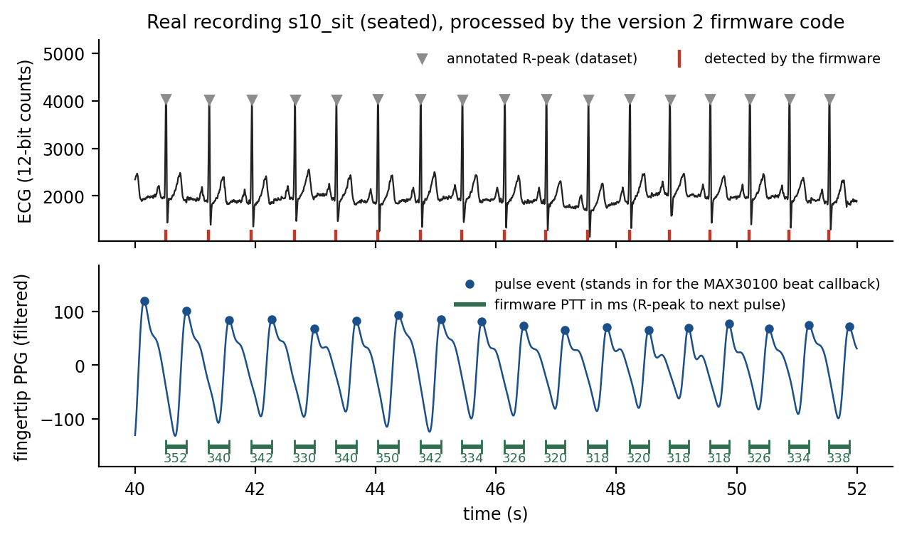
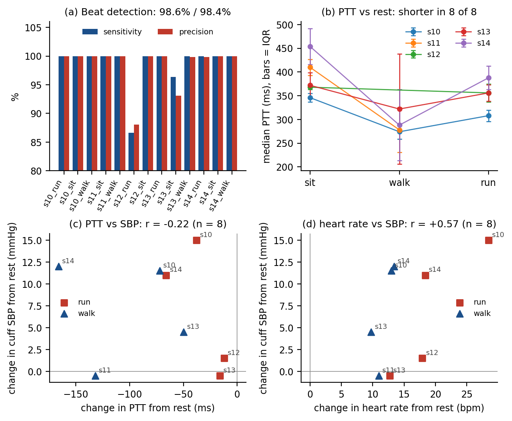

# Validation of version 2 on real recordings

This folder tests the revised firmware (`firmware/v2_revised/PTT_MONITOR_V2`) on **real ECG and fingertip-PPG recordings**
with **cuff blood pressure** readings, from a public dataset. It answers two questions: does version 2 find heartbeats and
measure pulse transit time (PTT) correctly on real signals, and does PTT track blood pressure?

**Short answer:** heartbeat detection and PTT measurement work well on real signals. Whether PTT estimates blood pressure
could not be settled with this dataset (see section 5).

## 1. Data

- **Pulse Transit Time PPG Dataset** (version 1.1.0), Mehrgardt, Khushi, Poon & Withana, PhysioNet, 2022,
  https://doi.org/10.13026/jpan-6n92 (Open Data Commons Open Database License v1.0).
- **13 recordings from 5 healthy people** (s10 to s14; ages 25 to 55; 1 woman), each about 8 minutes at 500 Hz: seated (5),
  walking on the spot (4) and running on the spot (4). Two possible recordings are absent (s11 running, s12 walking), so
  subjects s11 and s12 have two activities each.
- The ECG was recorded with an **AD8232**, the same ECG front end as this project. The fingertip PPG used a MAX30101
  sensor (red, infrared and green LEDs; only the red/infrared channels are used here, because the MAX30100 has no green LED).
- R-peaks are **manually verified annotations** supplied with the dataset. Blood pressure was measured with an OMRON HEM-7322
  cuff at the start and end of each recording (`data/subjects_info.csv`).

## 2. Method

The firmware file is **compiled unmodified for a PC** (`harness/firmware_host_test.cpp`) and run on each recording. Only the
hardware is replaced:

| Part | In the test |
|---|---|
| Firmware logic (R-peak detection, PTT pairing, median, CSV output) | **the real `PTT_MONITOR_V2.ino` source** |
| Clock and 250 Hz sampling | simulated clock; the firmware itself samples every other 2 ms tick |
| ECG input (`analogRead`) | the recorded ECG, reduced from the dataset's 16-bit range to the ESP32's 12-bit range |
| Pulse oximeter beat callback | **stand-in:** pulse events found in the recorded fingertip PPG (band-pass 0.75 to 5 Hz, systolic peaks, adaptive threshold) |
| LCD | ignored |

The PPG polarity was chosen from the pulse shape (a blood-volume pulse rises faster than it falls) and the red/infrared channel
by how many annotated R-peaks are followed by a pulse; both choices were made once for all recordings (`prepare_inputs.py`).
One change was made after inspecting the first figure: the stand-in's amplitude threshold was made adaptive (relative to nearby
pulses), because a single global threshold dropped a weak stretch of one recording. The real library also adapts its threshold.

## 3. Results

### 3.1 Heartbeat detection (firmware R-peaks vs manually verified annotations, matched within ±100 ms)

- **8,251 annotated beats, 8,262 detected, 8,132 matched:
  sensitivity 98.6%, precision 98.4%.**
- 11 of 13 recordings are above 99.5% on both measures. The two weaker ones are `s12_run` (86.6% / 88.1%) and
  `s13_sit` (96.3% / 93.1%); the cause was not investigated.
- Heart rate from the firmware's detections is within **0.15 bpm** (median) and 0.54 bpm (worst case)
  of the rate from the annotations.

### 3.2 Timing and PTT

- The firmware marks each beat on the steep upstroke of the QRS complex, **10 ms before** the annotated R-peak
  (8 to 14 ms depending on the person), with only **1.8 ms** of beat-to-beat variation in a recording.
- Compared with a reference PTT computed from the annotated R-peaks and the same pulse events, the firmware's PTT is
  **11 ms longer on average (a constant offset that a per-person calibration absorbs)** with typically 1.8 ms of added
  variation (median over recordings).
- The firmware produced **7,703 beat-by-beat PTT readings**.
- Mean of the recordings' median PTT: **seated 390 ms, walking 290 ms, running 352 ms.**
  PTT was shorter than at rest in **8 of 8** walking or running recordings. Running was not shorter than walking,
  unlike heart rate. One possible reason is movement artefact in the fingertip PPG; this was not tested.



### 3.3 The displayed PTT value: median instead of mean

The first version of the firmware showed the mean of the last 8 readings. In walking recordings some individual readings are far from the rest, so the
value jumped around. Switching to the **median of the last 8** (a change made after this test) reduced the typical spread of
the displayed value from 35 ms to 31 ms over all recordings
(37 to 30 ms for walking and running), and it improved 9 of 13 recordings.
It did not help `s13_walk` (spread 118 to 141 ms), a recording the dataset's authors flag as noisy for its ECG while walking, where individual readings
spread by 232 ms (IQR), too much for a median of 8 to help. Per-recording numbers: `results/mean_vs_median_displayed_spread.csv`.

### 3.4 Per recording

| Recording | Annotated beats | Sensitivity % | Precision % | Timing vs annotation (ms) | PTT readings | Median PTT (ms) | Cuff SBP, mean of start/end (mmHg) |
|---|---|---|---|---|---|---|---|
| s10_run | 825 | 100.0 | 100.0 | -8 ± 1.9 | 823 | 308 | 117 |
| s10_sit | 602 | 100.0 | 100.0 | -8 ± 1.4 | 601 | 346 | 102 |
| s10_walk | 706 | 100.0 | 100.0 | -8 ± 1.5 | 666 | 274 | 114 |
| s11_sit | 586 | 100.0 | 100.0 | -12 ± 2.2 | 577 | 410 | 103 |
| s11_walk | 673 | 100.0 | 100.0 | -12 ± 1.8 | 566 | 278 | 102 |
| s12_run | 724 | 86.6 | 88.1 | -12 ± 12.7 | 616 | 356 | 124 |
| s12_sit | 587 | 100.0 | 100.0 | -14 ± 1.9 | 586 | 368 | 122 |
| s13_run | 703 | 100.0 | 100.0 | -10 ± 1.5 | 703 | 356 | 132 |
| s13_sit | 601 | 96.3 | 93.1 | -12 ± 5.4 | 584 | 372 | 132 |
| s13_walk | 681 | 100.0 | 99.8 | -10 ± 1.6 | 511 | 322 | 137 |
| s14_run | 580 | 100.0 | 99.8 | -10 ± 2.0 | 577 | 388 | 160 |
| s14_sit | 442 | 100.0 | 100.0 | -12 ± 1.7 | 439 | 454 | 149 |
| s14_walk | 541 | 100.0 | 100.0 | -10 ± 1.8 | 454 | 288 | 161 |

## 4. Blood pressure

**Setup.** One resting (seated) cuff reading per person is the only calibration. For each walking or running recording, a
population slope (learned from the *other* four people, leave-one-subject-out) turns the change in PTT from rest into a predicted
change in blood pressure, which is compared with the change the cuff measured (8 comparisons in total). The cuff value for a recording
is the mean of its start and end readings; this choice was fixed before looking at results. Two baselines are shown:
predicting *no change*, and a model that uses the change in *heart rate* instead of PTT.

**Mean absolute error of the predicted change (mmHg), 8 comparisons:**

| Cuff reference | | Systolic: PTT | Systolic: no change | Systolic: heart rate | Diastolic: PTT | Diastolic: no change | Diastolic: heart rate |
|---|---|---|---|---|---|---|---|
| mean of start and end (planned) | | 5.9 | 7.1 | 5.5 | 3.5 | 3.4 | 2.1 |
| start reading only (check) | | 8.7 | 7.9 | 10.2 | 3.6 | 3.0 | 3.5 |
| end reading only (check) | | 11.1 | 15.5 | 6.8 | 3.8 | 4.4 | 2.7 |

Correlation between the change in PTT and the change in systolic pressure: **r = -0.22** (heart rate: r = +0.57), n = 8.



## 5. What this shows and what it does not

**Shown:** on real recordings, the version 2 firmware logic finds heartbeats reliably, measures beat-by-beat PTT with about
2 ms of jitter, and reports PTT that shortens with exertion in every comparison.

**Not shown: that PTT estimates blood pressure better than heart rate or than assuming no change.** The result depends on which
cuff reading is used, and the ranking of the methods changes between the three rows of the table. Reasons this dataset cannot settle the question:

- **The reference is noisy.** Seated systolic readings changed by **6 to 22 mmHg (mean 12.8)** between the start and end of the
  same 8-minute seated recording, which is larger than the average exercise-induced change in these people (7.1 mmHg).
- **Very little data:** 5 people and 8 comparisons.
- **Heart rate is a confounder:** exercise raises both heart rate and blood pressure, and heart rate alone predicted the change at least as well here.

Settling it would need more people, a steadier reference (several cuff readings at each stage), and recordings in which blood pressure
is changed without a large change in heart rate.

## 6. Limitations

- The pulse events come from an offline, zero-phase filter on the recorded PPG. The MAX30100 library works in real time and adds its own
  delay, which is not modelled (a constant delay is absorbed by calibration, but a delay that varies is not).
- The LCD's effect on timing on a real ESP32 (I2C writes delay sampling) is not modelled.
- The dataset's PPG sensor is a MAX30101, not the MAX30100 used in the project.
- All subjects are healthy; only one is a woman.
- The test used 13 of the 66 recordings in the dataset.

## 7. Reproduce

```bash
pip install -r validation/requirements.txt          # numpy, scipy, pandas, matplotlib (and a C++ compiler: g++)
# download the CSV recordings you want from
# https://www.physionet.org/content/pulse-transit-time-ppg/1.1.0/csv/   into one folder, then:
sh validation/run_validation.sh /path/to/folder
```

Outputs are written to `validation/results/` and `validation/figures/`.
